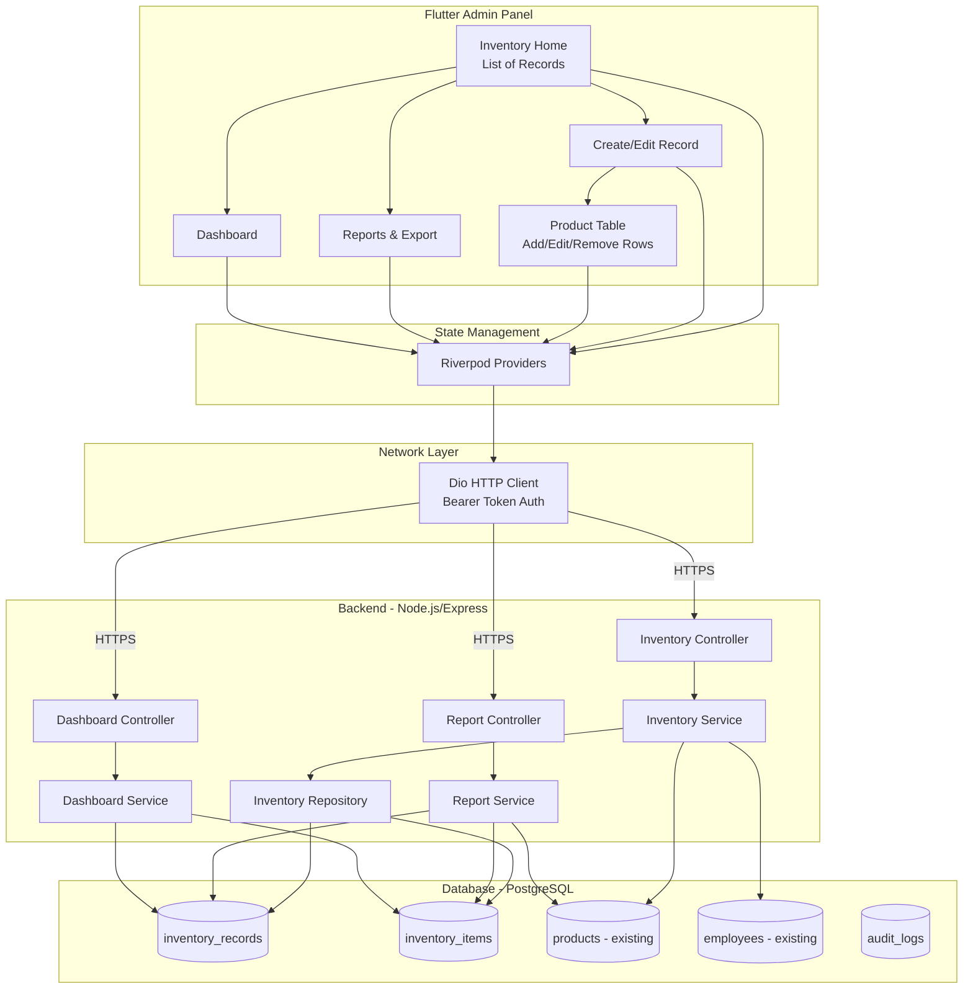
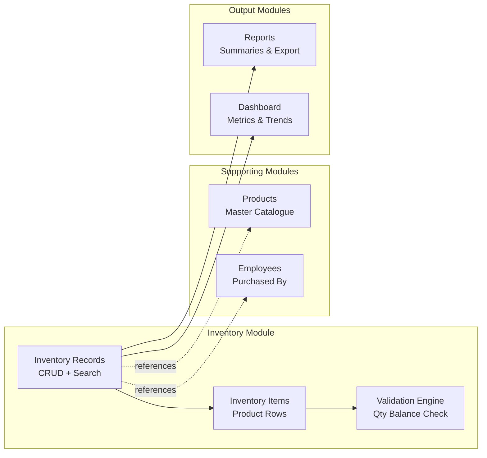
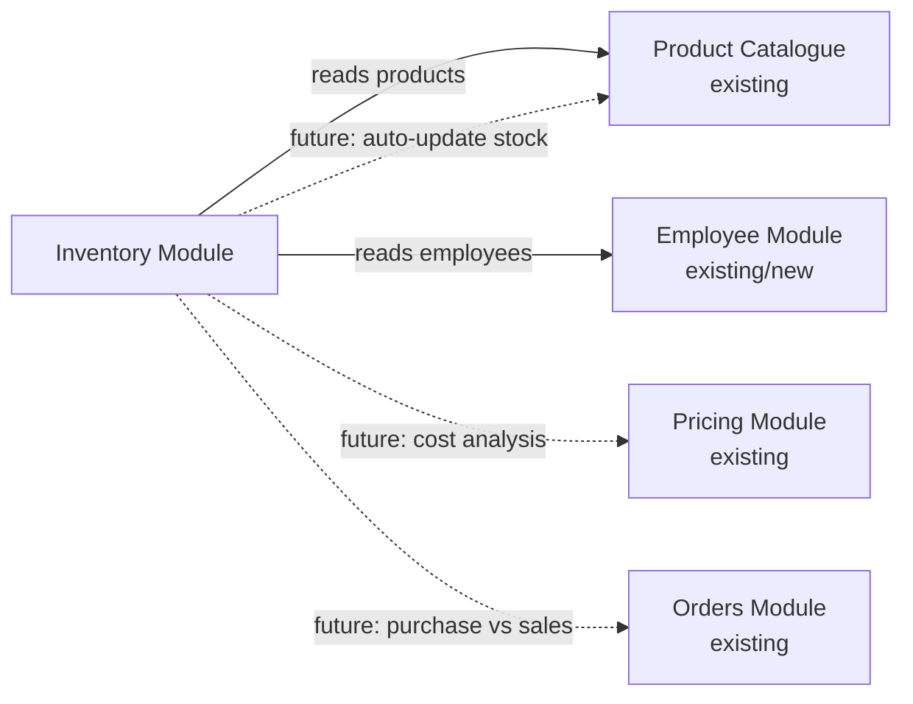

# System Architecture — Inventory Management System

## 1. Business Understanding

### The Real-World Workflow

Every morning (and sometimes evening), warehouse staff go to the mandi, purchase vegetables in bulk, bring them back, and sort them. A staff member opens a physical register notebook, writes the date and title ("Morning Purchase"), then creates a table:

```
┌───────────────────────────────────────────────────────────────────────┐
│  Page 47  |  Morning Purchase  |  25 Jul 2026  |  Purchased By: Om   │
├─────────────┬────────────┬────────────┬─────────────┬─────────────────┤
│  Product    │  Purchased │ Good Stock │ Recoverable │  Final Waste    │
├─────────────┼────────────┼────────────┼─────────────┼─────────────────┤
│  Potato     │    200 kg  │    180 kg  │      15 kg  │        5 kg     │
│  Onion      │    150 kg  │    140 kg  │       8 kg  │        2 kg     │
│  Tomato     │    100 kg  │     85 kg  │      10 kg  │        5 kg     │
│  ...        │            │            │             │                 │
└─────────────┴────────────┴────────────┴─────────────┴─────────────────┘
```

### Key Insight

This is **NOT** traditional ERP inventory management. There is:
- No purchase order workflow
- No supplier matching
- No GRN (Goods Receipt Note) process
- No bin locations
- No stock levels tracking (Phase 1)

It IS a **digital register** — each page is a standalone inventory record that captures what was purchased, what's sellable, what's recoverable, and what's waste.

---

## 2. High-Level Architecture



---

## 3. Module Architecture



---

## 4. Design Decisions

### 4.1 Why "Inventory Record" and Not "Purchase"?

The business says "purchase" but the record captures post-sorting data — not just what was bought but how it was graded. Calling it "Inventory Record" keeps it neutral for future extensions (returns, adjustments, transfers can also be record types).

### 4.2 Why No Stock Ledger in Phase 1?

Current business doesn't track running stock. They purchase daily, sort, sell same day. There's no warehouse "balance" concept yet. The architecture supports adding a stock ledger later by summing `good_stock` across records, but this isn't needed today.

### 4.3 Why Quantity Validation is Hard-Enforced?

```
purchased_qty = good_stock + recoverable + final_waste
```

This is a physical constraint — the total kg purchased MUST equal the sum of sorted categories. There's no "missing" category. If numbers don't add up, the sorting was recorded wrong. This validation runs both client-side (Flutter) and server-side (backend).

### 4.4 Why Multiple Records Per Day?

Different purchase trips happen at different times. Morning mandi visit, hotel-specific stock, evening top-up, special orders — each is a separate "page" in the register. The date is metadata, not a unique key.

### 4.5 Why Reference Existing Products Instead of Free-Text?

- Enables cross-record reporting (total potato purchased this month)
- Ensures consistent naming (no "Potato" vs "potato" vs "Aloo")
- Supports future: pricing, stock levels, categories
- Admin can still add new products to the catalogue on the fly

### 4.6 Why Soft Delete?

Inventory records are financial/operational data. Even "deleted" records should be recoverable for auditing. A `deleted_at` timestamp hides them from UI but preserves data integrity.

---

## 5. Responsibility Breakdown

| Component | Responsibility |
|-----------|---------------|
| **Inventory Record** | Container for a sorting session — title, date, who purchased |
| **Inventory Item** | One product row within a record — quantities and grades |
| **Validation Engine** | Enforces qty balance rule before save |
| **Product Catalogue** | Master list of products (existing module) |
| **Employee Reference** | Links to "purchased by" (from EMS or simple user list) |
| **Report Service** | Aggregates data across records for summaries |
| **Dashboard Service** | Real-time metrics and trend calculations |
| **Audit Logger** | Tracks who changed what and when |

---

## 6. Scalability Considerations

| Concern | Current Reality | Future Scale | Strategy |
|---------|----------------|--------------|----------|
| Records per day | 2-5 | 20-50 (multi-warehouse) | Indexed by date, paginated |
| Items per record | 10-30 products | 50-100 | Batch insert, no N+1 queries |
| Total records | ~100/month | ~1000/month | Date partitioning, archive old records |
| Concurrent users | 1-2 admins | 10-20 managers | Row-level locking on record edit |
| Report generation | Inline | Background jobs | Queue-based for large date ranges |
| Multi-warehouse | Single | 5-10 warehouses | Nullable `warehouse_id` FK (added later) |
| Product catalogue | ~50 products | 500+ SKUs | Already paginated with search |

---

## 7. Security Model

| Layer | Implementation |
|-------|---------------|
| Authentication | JWT Bearer token (existing) |
| Authorization | Role-based: `admin` can CRUD, future `manager` can only view |
| Data Isolation | Records scoped by authenticated user's org |
| Audit Trail | Every create/update/delete logged with user ID and timestamp |
| Soft Delete | Only hides from UI; data preserved for compliance |
| Input Validation | Server-side qty balance check prevents corrupt data |

---

## 8. Technology Stack

| Layer | Technology | Why |
|-------|-----------|-----|
| Frontend | Flutter + Riverpod + GoRouter + Dio | Matches existing admin panel |
| Backend | Node.js + Express | Existing infrastructure |
| Database | PostgreSQL | Existing; excellent for numeric aggregations |
| File Export | pdfkit (PDF), exceljs (Excel), csv-writer (CSV) | Server-side generation |
| Hosting | AWS ECS | Existing deployment |
| Storage | AWS S3 | Future: receipt photos, invoice scans |

---

## 9. Integration Points



**Phase 1:** Inventory reads from Products and Employees (read-only references).  
**Future:** Inventory writes back to Products (update stock levels), cross-references with Orders for margin analysis.
