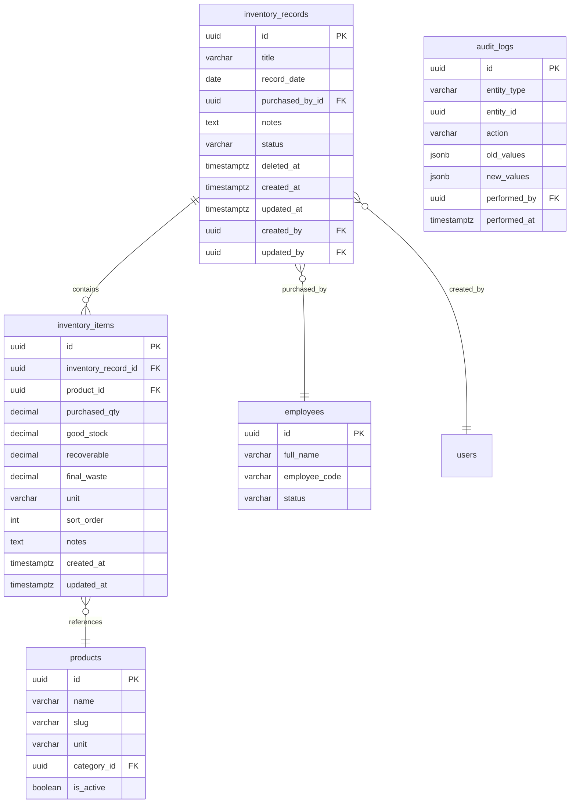

# Database Design — Inventory Management System

## 1. ER Diagram



---

## 2. Table Definitions

### 2.1 `inventory_records`

The "page" in the notebook — one per sorting session.

| Column | Type | Constraints | Description |
|--------|------|-------------|-------------|
| `id` | UUID | PK, DEFAULT gen_random_uuid() | Primary key |
| `title` | VARCHAR(200) | NOT NULL | Record title (e.g., "Morning Purchase") |
| `record_date` | DATE | NOT NULL | Date of purchase/sorting |
| `purchased_by_id` | UUID | FK → employees.id, NULL | Employee who purchased (nullable for flexibility) |
| `purchased_by_name` | VARCHAR(100) | NULL | Denormalized name (fallback if no employee record) |
| `notes` | TEXT | NULL | Optional notes |
| `status` | VARCHAR(20) | NOT NULL, DEFAULT 'draft' | draft, finalized |
| `total_purchased_qty` | DECIMAL(12,2) | NOT NULL, DEFAULT 0 | Cached aggregate |
| `total_good_stock` | DECIMAL(12,2) | NOT NULL, DEFAULT 0 | Cached aggregate |
| `total_recoverable` | DECIMAL(12,2) | NOT NULL, DEFAULT 0 | Cached aggregate |
| `total_final_waste` | DECIMAL(12,2) | NOT NULL, DEFAULT 0 | Cached aggregate |
| `item_count` | INTEGER | NOT NULL, DEFAULT 0 | Cached count of items |
| `deleted_at` | TIMESTAMPTZ | NULL | Soft delete marker |
| `created_at` | TIMESTAMPTZ | NOT NULL, DEFAULT NOW() | |
| `updated_at` | TIMESTAMPTZ | NOT NULL, DEFAULT NOW() | |
| `created_by` | UUID | FK → users.id | Who created this record |
| `updated_by` | UUID | FK → users.id | Who last updated |

**Why denormalized totals?**  
The home screen lists records with totals. Computing SUM on every list fetch creates unnecessary joins for 90% of reads. Totals are recomputed on every item save (single source of truth remains the items).

---

### 2.2 `inventory_items`

Individual product rows within a record.

| Column | Type | Constraints | Description |
|--------|------|-------------|-------------|
| `id` | UUID | PK, DEFAULT gen_random_uuid() | Primary key |
| `inventory_record_id` | UUID | FK → inventory_records.id, NOT NULL | Parent record |
| `product_id` | UUID | FK → products.id, NOT NULL | Reference to product catalogue |
| `purchased_qty` | DECIMAL(10,2) | NOT NULL, CHECK > 0 | Total purchased quantity |
| `good_stock` | DECIMAL(10,2) | NOT NULL, CHECK >= 0 | Sellable fresh stock |
| `recoverable` | DECIMAL(10,2) | NOT NULL, CHECK >= 0 | Lower grade but sellable |
| `final_waste` | DECIMAL(10,2) | NOT NULL, CHECK >= 0 | Unusable / discarded |
| `unit` | VARCHAR(20) | NOT NULL, DEFAULT 'kg' | Unit of measurement |
| `sort_order` | INTEGER | NOT NULL, DEFAULT 0 | Display order within record |
| `notes` | TEXT | NULL | Per-item notes |
| `created_at` | TIMESTAMPTZ | NOT NULL, DEFAULT NOW() | |
| `updated_at` | TIMESTAMPTZ | NOT NULL, DEFAULT NOW() | |

**Constraints:**
```sql
-- The fundamental business rule
CHECK (purchased_qty = good_stock + recoverable + final_waste)

-- No duplicate products in same record
UNIQUE (inventory_record_id, product_id)
```

---

## 3. Complete SQL Schema

```sql
-- ============================================================
-- INVENTORY RECORDS
-- ============================================================

CREATE TABLE inventory_records (
    id UUID PRIMARY KEY DEFAULT gen_random_uuid(),
    title VARCHAR(200) NOT NULL,
    record_date DATE NOT NULL,
    purchased_by_id UUID REFERENCES employees(id) ON DELETE SET NULL,
    purchased_by_name VARCHAR(100),
    notes TEXT,
    status VARCHAR(20) NOT NULL DEFAULT 'draft',
    
    -- Denormalized aggregates (recomputed on item changes)
    total_purchased_qty DECIMAL(12,2) NOT NULL DEFAULT 0,
    total_good_stock DECIMAL(12,2) NOT NULL DEFAULT 0,
    total_recoverable DECIMAL(12,2) NOT NULL DEFAULT 0,
    total_final_waste DECIMAL(12,2) NOT NULL DEFAULT 0,
    item_count INTEGER NOT NULL DEFAULT 0,
    
    -- Soft delete & audit
    deleted_at TIMESTAMPTZ,
    created_at TIMESTAMPTZ NOT NULL DEFAULT NOW(),
    updated_at TIMESTAMPTZ NOT NULL DEFAULT NOW(),
    created_by UUID REFERENCES users(id),
    updated_by UUID REFERENCES users(id),
    
    -- Constraints
    CONSTRAINT chk_status CHECK (status IN ('draft', 'finalized'))
);

-- ============================================================
-- INVENTORY ITEMS
-- ============================================================

CREATE TABLE inventory_items (
    id UUID PRIMARY KEY DEFAULT gen_random_uuid(),
    inventory_record_id UUID NOT NULL 
        REFERENCES inventory_records(id) ON DELETE CASCADE,
    product_id UUID NOT NULL 
        REFERENCES products(id) ON DELETE RESTRICT,
    
    purchased_qty DECIMAL(10,2) NOT NULL,
    good_stock DECIMAL(10,2) NOT NULL,
    recoverable DECIMAL(10,2) NOT NULL,
    final_waste DECIMAL(10,2) NOT NULL,
    
    unit VARCHAR(20) NOT NULL DEFAULT 'kg',
    sort_order INTEGER NOT NULL DEFAULT 0,
    notes TEXT,
    
    created_at TIMESTAMPTZ NOT NULL DEFAULT NOW(),
    updated_at TIMESTAMPTZ NOT NULL DEFAULT NOW(),
    
    -- Business rule: purchased = good + recoverable + waste
    CONSTRAINT chk_qty_balance 
        CHECK (purchased_qty = good_stock + recoverable + final_waste),
    
    -- No duplicate products per record
    CONSTRAINT uq_record_product 
        UNIQUE (inventory_record_id, product_id),
    
    -- All quantities must be non-negative
    CONSTRAINT chk_purchased_positive CHECK (purchased_qty > 0),
    CONSTRAINT chk_good_stock_positive CHECK (good_stock >= 0),
    CONSTRAINT chk_recoverable_positive CHECK (recoverable >= 0),
    CONSTRAINT chk_waste_positive CHECK (final_waste >= 0)
);
```

---

## 4. Indexes

```sql
-- ============================================================
-- INVENTORY RECORDS INDEXES
-- ============================================================

-- Primary listing query: active records by date (most recent first)
CREATE INDEX idx_inventory_records_date 
    ON inventory_records (record_date DESC) 
    WHERE deleted_at IS NULL;

-- Filter by status
CREATE INDEX idx_inventory_records_status 
    ON inventory_records (status) 
    WHERE deleted_at IS NULL;

-- Filter by purchased_by
CREATE INDEX idx_inventory_records_purchased_by 
    ON inventory_records (purchased_by_id) 
    WHERE deleted_at IS NULL;

-- Full-text search on title
CREATE INDEX idx_inventory_records_title_search 
    ON inventory_records USING gin (title gin_trgm_ops);

-- Date range queries for reports
CREATE INDEX idx_inventory_records_date_range 
    ON inventory_records (record_date, created_at) 
    WHERE deleted_at IS NULL;

-- ============================================================
-- INVENTORY ITEMS INDEXES
-- ============================================================

-- Get all items for a record (primary access pattern)
CREATE INDEX idx_inventory_items_record 
    ON inventory_items (inventory_record_id, sort_order);

-- Product-wise reports across all records
CREATE INDEX idx_inventory_items_product 
    ON inventory_items (product_id);

-- Aggregation queries (product + date range via join)
CREATE INDEX idx_inventory_items_product_record 
    ON inventory_items (product_id, inventory_record_id);
```

---

## 5. Soft Delete Strategy

| Table | Strategy | Reason |
|-------|----------|--------|
| `inventory_records` | `deleted_at` TIMESTAMPTZ | Preserve historical data; allow undo |
| `inventory_items` | CASCADE from parent record | Items live/die with their record |
| `products` (existing) | `is_active` flag | Never delete; inventory references them |
| `employees` (existing) | `deleted_at` | Never delete; records reference them |

**Query pattern:**  
All list/search queries include `WHERE deleted_at IS NULL` to hide soft-deleted records.

**Restore operation:**  
`UPDATE inventory_records SET deleted_at = NULL WHERE id = :id`

---

## 6. Audit Fields

Every table includes:
- `created_at` — record creation timestamp
- `updated_at` — last modification timestamp (auto-updated via trigger or application)
- `created_by` — user who created the record
- `updated_by` — user who last modified

Additionally, significant changes are logged to the `audit_logs` table:

```sql
-- Reuses the audit_logs table from EMS (or create if doesn't exist)
CREATE TABLE IF NOT EXISTS audit_logs (
    id UUID PRIMARY KEY DEFAULT gen_random_uuid(),
    entity_type VARCHAR(50) NOT NULL,
    entity_id UUID NOT NULL,
    action VARCHAR(20) NOT NULL,
    old_values JSONB,
    new_values JSONB,
    performed_by UUID NOT NULL REFERENCES users(id),
    performed_at TIMESTAMPTZ NOT NULL DEFAULT NOW()
);

CREATE INDEX idx_audit_logs_entity 
    ON audit_logs (entity_type, entity_id);
CREATE INDEX idx_audit_logs_performed_at 
    ON audit_logs (performed_at DESC);
```

**What gets audited:**
| Action | Logged? |
|--------|---------|
| Create inventory record | Yes |
| Update inventory record header | Yes (old + new values) |
| Add/update/remove items | Yes (per-item change) |
| Delete record (soft) | Yes |
| Restore record | Yes |
| Finalize record | Yes |

---

## 7. Denormalization & Cache Strategy

The `inventory_records` table stores cached totals (`total_purchased_qty`, etc.). This is maintained via:

**Option A: Application-level (recommended for Phase 1)**
```javascript
// After saving items, recompute totals
async function recomputeRecordTotals(recordId) {
  await db.query(`
    UPDATE inventory_records SET
      total_purchased_qty = COALESCE((SELECT SUM(purchased_qty) FROM inventory_items WHERE inventory_record_id = $1), 0),
      total_good_stock = COALESCE((SELECT SUM(good_stock) FROM inventory_items WHERE inventory_record_id = $1), 0),
      total_recoverable = COALESCE((SELECT SUM(recoverable) FROM inventory_items WHERE inventory_record_id = $1), 0),
      total_final_waste = COALESCE((SELECT SUM(final_waste) FROM inventory_items WHERE inventory_record_id = $1), 0),
      item_count = (SELECT COUNT(*) FROM inventory_items WHERE inventory_record_id = $1),
      updated_at = NOW()
    WHERE id = $1
  `, [recordId]);
}
```

**Option B: Database trigger (future, if performance requires)**
```sql
CREATE OR REPLACE FUNCTION update_inventory_totals()
RETURNS TRIGGER AS $$ ... $$;
```

---

## 8. Data Integrity Rules

| Rule | Enforcement | Level |
|------|-------------|-------|
| Qty balance: purchased = good + recoverable + waste | CHECK constraint + app validation | DB + App |
| No duplicate product per record | UNIQUE constraint | DB |
| All quantities > 0 (purchased) or >= 0 (others) | CHECK constraints | DB |
| Record date not in future | Application validation | App |
| Product must exist in catalogue | FK constraint | DB |
| Cannot delete product with inventory references | ON DELETE RESTRICT | DB |
| Soft-deleted records excluded from reports | WHERE clause | App |
| Totals always consistent with items | Recompute on save | App |

---

## 9. Migration Files

```
database/migrations/
├── 010_create_inventory_records_table.sql
├── 011_create_inventory_items_table.sql
├── 012_create_inventory_indexes.sql
└── 013_add_inventory_audit_triggers.sql
```

Each migration is idempotent and includes a rollback counterpart.

---

## 10. Future Schema Extensions

These columns/tables can be added **without modifying existing tables**:

| Feature | Schema Change |
|---------|--------------|
| Warehouse locations | `ALTER TABLE inventory_records ADD COLUMN warehouse_id UUID` |
| Supplier tracking | `ALTER TABLE inventory_records ADD COLUMN supplier_id UUID` |
| Purchase cost | `ALTER TABLE inventory_items ADD COLUMN unit_price DECIMAL(10,2)` |
| Batch tracking | `ALTER TABLE inventory_items ADD COLUMN batch_number VARCHAR(50)` |
| Expiry dates | `ALTER TABLE inventory_items ADD COLUMN expiry_date DATE` |
| Photo attachments | New table: `inventory_record_attachments` |
| Approval workflow | `ALTER TABLE inventory_records ADD COLUMN approved_by UUID, ADD COLUMN approved_at TIMESTAMPTZ` |
| Stock ledger | New table: `stock_ledger` with running balances |
| Packing | New table: `packing_records` referencing `inventory_items` |
| Returns | `ALTER TABLE inventory_records ADD COLUMN record_type VARCHAR(20) DEFAULT 'purchase'` |
