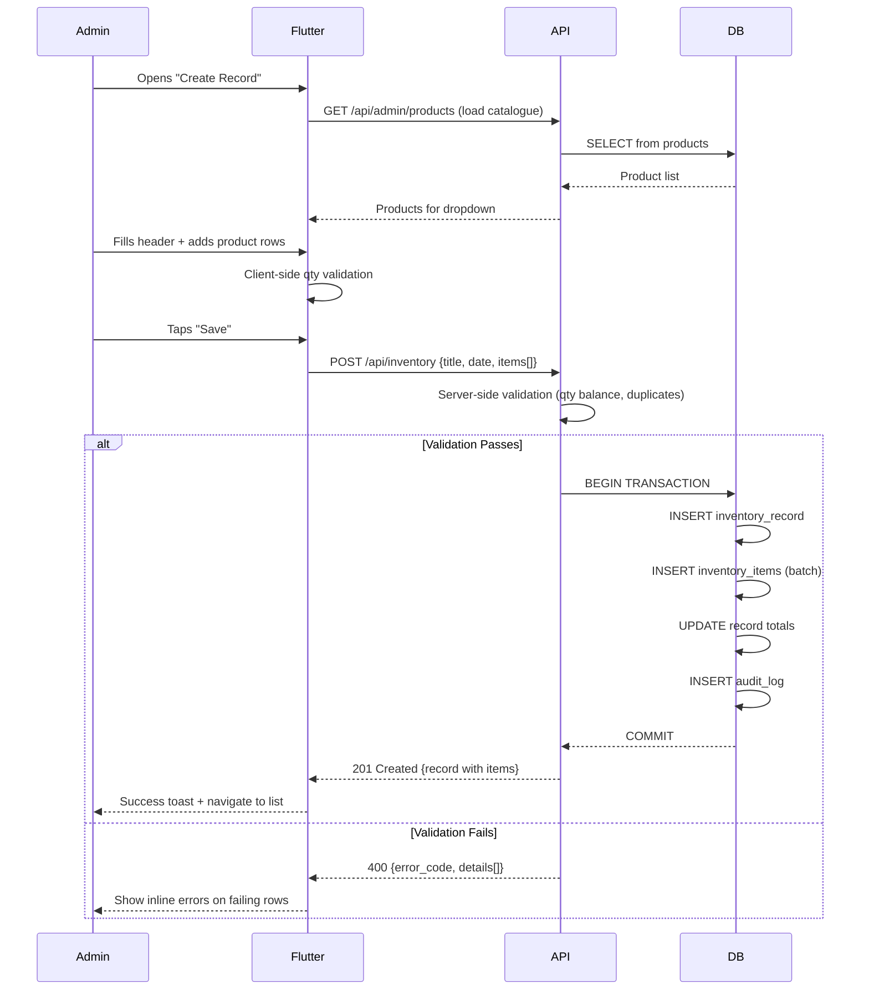

# API Design — Inventory Management System

## Base URL

```
/api/inventory          — Inventory records CRUD
/api/inventory/:id/items — Items within a record
/api/inventory/reports  — Report generation
/api/inventory/dashboard — Dashboard metrics
```

All endpoints require `Authorization: Bearer <token>`.  
Standard response shape: `{ success: true, data: {...} }` or `{ success: false, message: "...", error_code: "..." }`.

---

## 1. Inventory Records APIs

### 1.1 List Inventory Records

```
GET /api/inventory
```

**Query Parameters:**

| Param | Type | Default | Description |
|-------|------|---------|-------------|
| `page` | number | 1 | Page number |
| `limit` | number | 20 | Items per page (max 100) |
| `search` | string | — | Search title (ILIKE) |
| `date` | string | — | Exact date filter (YYYY-MM-DD) |
| `start_date` | string | — | Range start (inclusive) |
| `end_date` | string | — | Range end (inclusive) |
| `purchased_by` | UUID | — | Filter by employee |
| `status` | string | — | draft, finalized |
| `sort_by` | string | record_date | record_date, created_at, title |
| `sort_order` | string | desc | asc, desc |

**Response: `200 OK`**

```json
{
  "success": true,
  "data": {
    "records": [
      {
        "id": "a1b2c3d4-...",
        "title": "Morning Purchase",
        "record_date": "2026-07-25",
        "purchased_by_id": "emp-uuid",
        "purchased_by_name": "Om",
        "status": "draft",
        "item_count": 12,
        "total_purchased_qty": 1580.00,
        "total_good_stock": 1420.50,
        "total_recoverable": 112.00,
        "total_final_waste": 47.50,
        "notes": null,
        "created_at": "2026-07-25T06:30:00Z"
      }
    ],
    "pagination": {
      "page": 1,
      "limit": 20,
      "total": 87,
      "total_pages": 5
    }
  }
}
```

---

### 1.2 Get Single Inventory Record

```
GET /api/inventory/:id
```

Returns the record header **and all items** (since items are always viewed together).

**Response: `200 OK`**

```json
{
  "success": true,
  "data": {
    "id": "a1b2c3d4-...",
    "title": "Morning Purchase",
    "record_date": "2026-07-25",
    "purchased_by_id": "emp-uuid",
    "purchased_by_name": "Om",
    "status": "draft",
    "notes": "Heavy monsoon, limited stock available",
    "total_purchased_qty": 450.00,
    "total_good_stock": 395.00,
    "total_recoverable": 40.00,
    "total_final_waste": 15.00,
    "item_count": 3,
    "items": [
      {
        "id": "item-uuid-1",
        "product_id": "prod-uuid-1",
        "product_name": "Potato",
        "product_unit": "kg",
        "purchased_qty": 200.00,
        "good_stock": 180.00,
        "recoverable": 15.00,
        "final_waste": 5.00,
        "unit": "kg",
        "sort_order": 0,
        "notes": null
      },
      {
        "id": "item-uuid-2",
        "product_id": "prod-uuid-2",
        "product_name": "Onion",
        "product_unit": "kg",
        "purchased_qty": 150.00,
        "good_stock": 140.00,
        "recoverable": 8.00,
        "final_waste": 2.00,
        "unit": "kg",
        "sort_order": 1,
        "notes": null
      },
      {
        "id": "item-uuid-3",
        "product_id": "prod-uuid-3",
        "product_name": "Tomato",
        "product_unit": "kg",
        "purchased_qty": 100.00,
        "good_stock": 75.00,
        "recoverable": 17.00,
        "final_waste": 8.00,
        "unit": "kg",
        "sort_order": 2,
        "notes": "Mostly overripe"
      }
    ],
    "created_at": "2026-07-25T06:30:00Z",
    "updated_at": "2026-07-25T07:15:00Z",
    "created_by": "admin-uuid"
  }
}
```

---

### 1.3 Create Inventory Record

```
POST /api/inventory
```

Creates the record **with items** in a single request (atomic operation).

**Request Body:**

```json
{
  "title": "Morning Purchase",
  "record_date": "2026-07-25",
  "purchased_by_id": "emp-uuid",
  "notes": "Heavy monsoon, limited stock available",
  "items": [
    {
      "product_id": "prod-uuid-1",
      "purchased_qty": 200,
      "good_stock": 180,
      "recoverable": 15,
      "final_waste": 5,
      "unit": "kg",
      "notes": null
    },
    {
      "product_id": "prod-uuid-2",
      "purchased_qty": 150,
      "good_stock": 140,
      "recoverable": 8,
      "final_waste": 2,
      "unit": "kg",
      "notes": null
    }
  ]
}
```

**Validation Rules:**

| Field | Rules |
|-------|-------|
| `title` | Required, 2-200 characters |
| `record_date` | Required, valid date, not in future |
| `purchased_by_id` | Optional UUID, must exist if provided |
| `notes` | Optional, max 1000 chars |
| `items` | Required, array with at least 1 item |
| `items[].product_id` | Required, must exist in products table |
| `items[].purchased_qty` | Required, > 0, max 99999.99 |
| `items[].good_stock` | Required, >= 0 |
| `items[].recoverable` | Required, >= 0 |
| `items[].final_waste` | Required, >= 0 |
| **Balance check** | `purchased_qty == good_stock + recoverable + final_waste` for EACH item |
| **No duplicates** | Same product_id cannot appear twice in items array |

**Response: `201 Created`**

```json
{
  "success": true,
  "data": {
    "id": "new-record-uuid",
    "title": "Morning Purchase",
    "...": "...full record with items..."
  }
}
```

---

### 1.4 Update Inventory Record

```
PUT /api/inventory/:id
```

**Full replacement of record and items.** The entire items array is provided — the backend reconciles (adds new, updates existing, removes missing).

**Request Body:** Same shape as create.

**Business Rules:**
- Cannot update if record is `finalized` (must un-finalize first)
- All validation rules from create apply
- Denormalized totals are recomputed
- Audit log captures diff

**Response: `200 OK`** with updated record.

---

### 1.5 Delete Inventory Record (Soft)

```
DELETE /api/inventory/:id
```

Sets `deleted_at = NOW()`. Record disappears from listing but data preserved.

**Response: `200 OK`**

```json
{
  "success": true,
  "message": "Inventory record deleted"
}
```

---

### 1.6 Restore Inventory Record

```
POST /api/inventory/:id/restore
```

Sets `deleted_at = NULL`. Brings record back.

**Response: `200 OK`**

---

### 1.7 Finalize Inventory Record

```
POST /api/inventory/:id/finalize
```

Marks record as `finalized` — prevents further edits (can be un-finalized by admin).

**Business Rule:** All items must pass qty balance check before finalizing.

**Response: `200 OK`**

---

### 1.8 Un-finalize Inventory Record

```
POST /api/inventory/:id/unfinalize
```

Returns record to `draft` status for editing.

**Response: `200 OK`**

---

## 2. Inventory Items APIs

While items are typically saved with the full record (1.3, 1.4), these endpoints allow granular operations for real-time editing UX:

### 2.1 Add Item to Record

```
POST /api/inventory/:id/items
```

**Request Body:**

```json
{
  "product_id": "prod-uuid",
  "purchased_qty": 100,
  "good_stock": 85,
  "recoverable": 10,
  "final_waste": 5,
  "unit": "kg",
  "notes": null
}
```

**Validation:** Same item-level rules + qty balance check + duplicate product check.

**Response: `201 Created`** with the new item + updated record totals.

---

### 2.2 Update Item

```
PUT /api/inventory/:id/items/:itemId
```

**Request Body:** Same as add (partial updates allowed).

**Response: `200 OK`** with updated item + updated record totals.

---

### 2.3 Delete Item

```
DELETE /api/inventory/:id/items/:itemId
```

Hard deletes the item (items don't have independent lifecycle outside their record).

**Response: `200 OK`** with updated record totals.

---

## 3. Reports APIs

### 3.1 Inventory Summary Report

```
GET /api/inventory/reports/summary?start_date=2026-07-01&end_date=2026-07-31
```

**Response:**

```json
{
  "success": true,
  "data": {
    "period": { "start": "2026-07-01", "end": "2026-07-31" },
    "total_records": 45,
    "total_purchased_qty": 18500.00,
    "total_good_stock": 16200.00,
    "total_recoverable": 1650.00,
    "total_final_waste": 650.00,
    "good_stock_percentage": 87.57,
    "recoverable_percentage": 8.92,
    "waste_percentage": 3.51
  }
}
```

---

### 3.2 Product-wise Summary

```
GET /api/inventory/reports/products?start_date=2026-07-01&end_date=2026-07-31
```

**Response:**

```json
{
  "success": true,
  "data": {
    "period": { "start": "2026-07-01", "end": "2026-07-31" },
    "products": [
      {
        "product_id": "uuid",
        "product_name": "Potato",
        "unit": "kg",
        "total_purchased": 4200.00,
        "total_good_stock": 3800.00,
        "total_recoverable": 280.00,
        "total_waste": 120.00,
        "waste_percentage": 2.86,
        "record_count": 28
      },
      {
        "product_id": "uuid",
        "product_name": "Tomato",
        "unit": "kg",
        "total_purchased": 2800.00,
        "total_good_stock": 2200.00,
        "total_recoverable": 380.00,
        "total_waste": 220.00,
        "waste_percentage": 7.86,
        "record_count": 25
      }
    ]
  }
}
```

---

### 3.3 Waste Summary

```
GET /api/inventory/reports/waste?start_date=2026-07-01&end_date=2026-07-31&sort_by=waste_percentage&sort_order=desc
```

Returns products sorted by waste percentage — highlights problematic items.

---

### 3.4 Recoverable Summary

```
GET /api/inventory/reports/recoverable?start_date=2026-07-01&end_date=2026-07-31
```

Returns products sorted by recoverable quantity — helps plan hotel/bulk sales.

---

### 3.5 Employee Purchase Summary

```
GET /api/inventory/reports/employees?start_date=2026-07-01&end_date=2026-07-31
```

**Response:**

```json
{
  "success": true,
  "data": {
    "employees": [
      {
        "employee_id": "uuid",
        "employee_name": "Om",
        "record_count": 20,
        "total_purchased": 9800.00,
        "total_waste": 350.00,
        "avg_waste_percentage": 3.57
      }
    ]
  }
}
```

---

### 3.6 Export Report

```
GET /api/inventory/reports/export?type=product_summary&start_date=2026-07-01&end_date=2026-07-31&format=pdf
```

**Parameters:**

| Param | Values |
|-------|--------|
| `type` | summary, product_summary, waste_summary, recoverable_summary, employee_summary |
| `format` | pdf, excel, csv |
| `start_date` | Required |
| `end_date` | Required |

**Response:** Binary file download with `Content-Disposition: attachment; filename="..."`.

---

## 4. Dashboard API

### 4.1 Get Inventory Dashboard

```
GET /api/inventory/dashboard?period=this_month
```

**Parameters:**

| Param | Values | Default |
|-------|--------|---------|
| `period` | today, this_week, this_month, last_month, custom | this_month |
| `start_date` | date | — (for custom) |
| `end_date` | date | — (for custom) |

**Response:**

```json
{
  "success": true,
  "data": {
    "period": { "start": "2026-07-01", "end": "2026-07-25" },
    "metrics": {
      "total_records": 45,
      "total_purchased_qty": 18500.00,
      "total_good_stock": 16200.00,
      "total_recoverable": 1650.00,
      "total_final_waste": 650.00,
      "good_stock_percentage": 87.57,
      "waste_percentage": 3.51
    },
    "top_purchased_products": [
      { "product_name": "Potato", "total_qty": 4200.00, "unit": "kg" },
      { "product_name": "Onion", "total_qty": 3500.00, "unit": "kg" },
      { "product_name": "Tomato", "total_qty": 2800.00, "unit": "kg" }
    ],
    "highest_waste_products": [
      { "product_name": "Tomato", "waste_qty": 220.00, "waste_pct": 7.86 },
      { "product_name": "Capsicum", "waste_qty": 85.00, "waste_pct": 6.50 }
    ],
    "highest_recoverable_products": [
      { "product_name": "Potato", "recoverable_qty": 280.00, "pct": 6.67 },
      { "product_name": "Cabbage", "recoverable_qty": 150.00, "pct": 8.33 }
    ],
    "daily_trend": [
      { "date": "2026-07-01", "purchased": 650, "good_stock": 580, "waste": 25 },
      { "date": "2026-07-02", "purchased": 720, "good_stock": 640, "waste": 30 }
    ]
  }
}
```

---

## 5. Error Handling

### Standard Error Codes

| Error Code | HTTP Status | Description |
|------------|-------------|-------------|
| `VALIDATION_ERROR` | 400 | Request body validation failed |
| `QTY_BALANCE_ERROR` | 400 | purchased != good + recoverable + waste |
| `DUPLICATE_PRODUCT` | 409 | Same product added twice in one record |
| `RECORD_NOT_FOUND` | 404 | Inventory record doesn't exist |
| `RECORD_FINALIZED` | 403 | Cannot edit finalized record |
| `PRODUCT_NOT_FOUND` | 404 | Product ID doesn't exist in catalogue |
| `EMPLOYEE_NOT_FOUND` | 404 | Employee ID doesn't exist |
| `FUTURE_DATE` | 400 | Record date is in the future |
| `UNAUTHORIZED` | 401 | Invalid or expired token |
| `FORBIDDEN` | 403 | Insufficient permissions |

### Validation Error Response

```json
{
  "success": false,
  "message": "Validation failed",
  "error_code": "VALIDATION_ERROR",
  "details": [
    {
      "field": "items[0]",
      "message": "Quantity mismatch: purchased (200) != good_stock (170) + recoverable (15) + final_waste (5) = 190"
    },
    {
      "field": "items[2].product_id",
      "message": "Product already exists in this record"
    }
  ]
}
```

### Qty Balance Error (Specific)

```json
{
  "success": false,
  "message": "Quantity balance check failed",
  "error_code": "QTY_BALANCE_ERROR",
  "details": [
    {
      "item_index": 0,
      "product_name": "Potato",
      "purchased_qty": 200,
      "sum_of_parts": 190,
      "difference": 10,
      "message": "Purchased (200) does not equal Good Stock (170) + Recoverable (15) + Final Waste (5) = 190. Difference: 10 kg"
    }
  ]
}
```

---

## 6. API Flow Diagram


