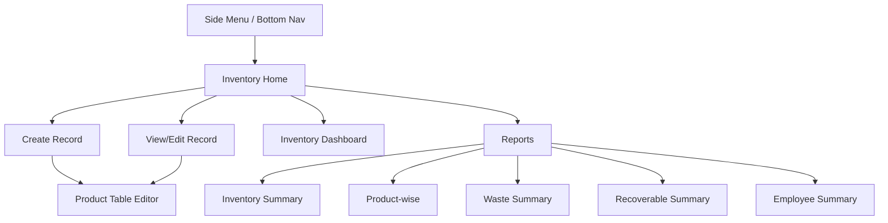

# UI Flow — Inventory Management System

## 1. Navigation Structure



---

## 2. Inventory Home Screen

The landing page for the inventory module — a list of all inventory records, designed like a register index.

### Layout

```
┌────────────────────────────────────────────────────────────────┐
│  ◀ Menu        Inventory Records          [+ New Record]       │
├────────────────────────────────────────────────────────────────┤
│  ┌──────────────────────────────────────────────────────────┐  │
│  │ 🔍 Search by title...           [Date Filter ▼]          │  │
│  └──────────────────────────────────────────────────────────┘  │
│                                                                │
│  ┌──────────────────────────────────────────────────────────┐  │
│  │  Morning Purchase                           25 Jul 2026  │  │
│  │  Purchased By: Om                                        │  │
│  │  ──────────────────────────────────────────────────────  │  │
│  │  Products: 12  │  Purchased: 1,580 kg                    │  │
│  │  Good: 1,420 kg │ Recoverable: 112 kg │ Waste: 48 kg    │  │
│  │                                          [Edit] [Delete] │  │
│  └──────────────────────────────────────────────────────────┘  │
│                                                                │
│  ┌──────────────────────────────────────────────────────────┐  │
│  │  Hotel Stock                                25 Jul 2026  │  │
│  │  Purchased By: Raju                                      │  │
│  │  ──────────────────────────────────────────────────────  │  │
│  │  Products: 6   │  Purchased: 420 kg                      │  │
│  │  Good: 380 kg  │ Recoverable: 30 kg  │ Waste: 10 kg     │  │
│  │                                          [Edit] [Delete] │  │
│  └──────────────────────────────────────────────────────────┘  │
│                                                                │
│  ┌──────────────────────────────────────────────────────────┐  │
│  │  Evening Purchase                           24 Jul 2026  │  │
│  │  ...                                                     │  │
│  └──────────────────────────────────────────────────────────┘  │
│                                                                │
│              ─── Page 1 of 5 ───  [< Prev] [Next >]            │
└────────────────────────────────────────────────────────────────┘
```

### Interactions
- **Tap card** → Opens record in detail/edit mode
- **[+ New Record]** → Opens create form
- **Search** → Filters by title (debounced, 300ms)
- **Date Filter** → Dropdown: Today, This Week, This Month, Custom Range
- **[Delete]** → Confirmation dialog → Soft delete
- **Pull to refresh** → Reloads list
- **Infinite scroll** or pagination at bottom

---

## 3. Create / Edit Record Screen

A single screen that works for both create and edit modes.

### Header Section

```
┌────────────────────────────────────────────────────────────────┐
│  ◀ Back       New Inventory Record          [Save]  [Cancel]   │
├────────────────────────────────────────────────────────────────┤
│                                                                │
│  Title *                                                       │
│  ┌──────────────────────────────────────────────────────────┐  │
│  │ Morning Purchase                                          │  │
│  └──────────────────────────────────────────────────────────┘  │
│                                                                │
│  Date *                           Purchased By                 │
│  ┌─────────────────────┐         ┌─────────────────────────┐  │
│  │ 25 Jul 2026    📅   │         │ Om                  ▼   │  │
│  └─────────────────────┘         └─────────────────────────┘  │
│                                                                │
│  Notes                                                         │
│  ┌──────────────────────────────────────────────────────────┐  │
│  │ Heavy monsoon, limited stock available                    │  │
│  └──────────────────────────────────────────────────────────┘  │
│                                                                │
├────────────────────────────────────────────────────────────────┤
│  Products                                   [+ Add Product]    │
│                                                                │
```

### Product Table Section

```
├────────────────────────────────────────────────────────────────┤
│  ┌────────────────────────────────────────────────────────┐    │
│  │  1. Potato (kg)                              [✕ Remove]│    │
│  │  ┌──────────┐ ┌──────────┐ ┌──────────┐ ┌──────────┐ │    │
│  │  │Purchased │ │Good Stock│ │Recoverable│ │  Waste   │ │    │
│  │  │   200    │ │   180    │ │    15     │ │    5     │ │    │
│  │  └──────────┘ └──────────┘ └──────────┘ └──────────┘ │    │
│  │  ✓ Balance OK: 180 + 15 + 5 = 200                     │    │
│  └────────────────────────────────────────────────────────┘    │
│                                                                │
│  ┌────────────────────────────────────────────────────────┐    │
│  │  2. Onion (kg)                               [✕ Remove]│    │
│  │  ┌──────────┐ ┌──────────┐ ┌──────────┐ ┌──────────┐ │    │
│  │  │Purchased │ │Good Stock│ │Recoverable│ │  Waste   │ │    │
│  │  │   150    │ │   140    │ │     8     │ │    2     │ │    │
│  │  └──────────┘ └──────────┘ └──────────┘ └──────────┘ │    │
│  │  ✓ Balance OK: 140 + 8 + 2 = 150                      │    │
│  └────────────────────────────────────────────────────────┘    │
│                                                                │
│  ┌────────────────────────────────────────────────────────┐    │
│  │  3. Tomato (kg)                              [✕ Remove]│    │
│  │  ┌──────────┐ ┌──────────┐ ┌──────────┐ ┌──────────┐ │    │
│  │  │Purchased │ │Good Stock│ │Recoverable│ │  Waste   │ │    │
│  │  │   100    │ │    75    │ │    17     │ │    8     │ │    │
│  │  └──────────┘ └──────────┘ └──────────┘ └──────────┘ │    │
│  │  ✗ MISMATCH: 75 + 17 + 8 = 100 ≠ 100 ... wait ✓ OK   │    │
│  └────────────────────────────────────────────────────────┘    │
│                                                                │
│        ┌─────────────────────────────────────────┐             │
│        │     [+ Add Product]                     │             │
│        └─────────────────────────────────────────┘             │
│                                                                │
├────────────────────────────────────────────────────────────────┤
│  Summary                                                       │
│  Total Purchased: 450 kg  │ Good: 395 kg │ Recoverable: 40 kg │
│  Waste: 15 kg  │  Waste %: 3.3%                               │
├────────────────────────────────────────────────────────────────┤
│                                                                │
│               [        Save Record        ]                    │
│                                                                │
└────────────────────────────────────────────────────────────────┘
```

---

## 4. Add Product Dialog / Bottom Sheet

When user taps [+ Add Product]:

```
┌────────────────────────────────────────────────────────────────┐
│                    Select Product                               │
├────────────────────────────────────────────────────────────────┤
│  🔍 Search product...                                          │
│                                                                │
│  ┌─────────────────────────────┐                               │
│  │ ● Potato (kg)               │  ← already added (disabled)  │
│  │ ● Onion (kg)                │  ← already added (disabled)  │
│  │ ○ Cabbage (kg)              │                               │
│  │ ○ Capsicum (kg)             │                               │
│  │ ○ Cauliflower (kg)          │                               │
│  │ ○ Carrot (kg)               │                               │
│  │ ○ Beans (kg)                │                               │
│  │ ...                         │                               │
│  └─────────────────────────────┘                               │
│                                                                │
│  [Cancel]                              [Add Selected]          │
└────────────────────────────────────────────────────────────────┘
```

- Products already in the record are shown as disabled/greyed
- Search filters product list
- Multi-select supported (add several at once)
- Added products appear with empty quantity fields

---

## 5. Validation UX

### Real-time Validation (Per Row)

As the user types quantities, validate **inline** and immediately:

**Valid state:**
```
┌──────────┐ ┌──────────┐ ┌──────────┐ ┌──────────┐
│   200    │ │   180    │ │    15    │ │    5     │
└──────────┘ └──────────┘ └──────────┘ └──────────┘
✓ 180 + 15 + 5 = 200                    (green text)
```

**Invalid state:**
```
┌──────────┐ ┌──────────┐ ┌──────────┐ ┌──────────┐
│   200    │ │   170    │ │    15    │ │    5     │
└──────────┘ └──────────┘ └──────────┘ └──────────┘
✗ 170 + 15 + 5 = 190 ≠ 200 (off by 10) (red text)
```

### Save Button Behavior

| Condition | Save Button |
|-----------|-------------|
| All rows valid | Enabled (primary color) |
| Any row invalid | Disabled (greyed) + tooltip showing which rows fail |
| Empty rows (no qty entered) | Warn but allow if at least 1 complete row |
| No items at all | Disabled |

### Error Messages

| Scenario | Message |
|----------|---------|
| Qty mismatch | "Purchased (200) ≠ Good Stock (170) + Recoverable (15) + Waste (5) = 190. Difference: 10 kg" |
| Duplicate product | "Potato is already added to this record" |
| Missing title | "Record title is required" |
| Future date | "Date cannot be in the future" |
| Negative qty | "Quantity cannot be negative" |
| Zero purchased | "Purchased quantity must be greater than 0" |

---

## 6. Record Detail / View Mode

When user taps an existing record from the list:

```
┌────────────────────────────────────────────────────────────────┐
│  ◀ Back       Morning Purchase                [Edit] [⋮ More]  │
├────────────────────────────────────────────────────────────────┤
│                                                                │
│  📅 25 Jul 2026              👤 Purchased By: Om               │
│  📝 Heavy monsoon, limited stock                               │
│  Status: Draft                                                 │
│                                                                │
├────────────────────────────────────────────────────────────────┤
│  Products (3)                                                  │
│                                                                │
│  ┌──────────┬──────────┬──────────┬──────────┬──────────┐     │
│  │ Product  │Purchased │  Good    │ Recover. │  Waste   │     │
│  ├──────────┼──────────┼──────────┼──────────┼──────────┤     │
│  │ Potato   │  200 kg  │  180 kg  │   15 kg  │    5 kg  │     │
│  │ Onion    │  150 kg  │  140 kg  │    8 kg  │    2 kg  │     │
│  │ Tomato   │  100 kg  │   75 kg  │   17 kg  │    8 kg  │     │
│  ├──────────┼──────────┼──────────┼──────────┼──────────┤     │
│  │ TOTAL    │  450 kg  │  395 kg  │   40 kg  │   15 kg  │     │
│  └──────────┴──────────┴──────────┴──────────┴──────────┘     │
│                                                                │
│  Summary                                                       │
│  ┌──────────────────────────────────────────────────────────┐  │
│  │  Good Stock:    87.8%  ████████████████████░░░           │  │
│  │  Recoverable:   8.9%  ██░░░░░░░░░░░░░░░░░░░░░           │  │
│  │  Waste:          3.3%  █░░░░░░░░░░░░░░░░░░░░░░           │  │
│  └──────────────────────────────────────────────────────────┘  │
│                                                                │
│  Created: 25 Jul 2026, 6:30 AM by Admin                       │
│  Last Updated: 25 Jul 2026, 7:15 AM                           │
│                                                                │
└────────────────────────────────────────────────────────────────┘
```

### More Menu (⋮)
- Finalize Record
- Duplicate Record
- Export as PDF
- Delete Record

---

## 7. Dashboard Screen

```
┌────────────────────────────────────────────────────────────────┐
│  ◀ Menu       Inventory Dashboard       [This Month ▼]         │
├────────────────────────────────────────────────────────────────┤
│                                                                │
│  ┌─────────────┐ ┌─────────────┐ ┌─────────────┐             │
│  │   Records   │ │  Purchased  │ │ Good Stock  │             │
│  │     45      │ │  18,500 kg  │ │  16,200 kg  │             │
│  │  this month │ │             │ │   (87.6%)   │             │
│  └─────────────┘ └─────────────┘ └─────────────┘             │
│                                                                │
│  ┌─────────────┐ ┌─────────────┐                              │
│  │ Recoverable │ │   Waste     │                              │
│  │  1,650 kg   │ │   650 kg    │                              │
│  │   (8.9%)    │ │   (3.5%)    │                              │
│  └─────────────┘ └─────────────┘                              │
│                                                                │
├────────────────────────────────────────────────────────────────┤
│  Top Purchased Products                                        │
│  1. Potato      4,200 kg  ████████████████████                 │
│  2. Onion       3,500 kg  ████████████████                     │
│  3. Tomato      2,800 kg  █████████████                        │
│  4. Capsicum    1,200 kg  ██████                               │
│  5. Cabbage       900 kg  ████                                 │
│                                                                │
├────────────────────────────────────────────────────────────────┤
│  Highest Waste (Attention Required)                            │
│  1. Tomato      7.9%  🔴                                       │
│  2. Capsicum    6.5%  🟡                                       │
│  3. Spinach     5.2%  🟡                                       │
│                                                                │
├────────────────────────────────────────────────────────────────┤
│  Daily Purchase Trend (July 2026)                              │
│                                                                │
│  800 ┤        ╭─╮                                              │
│  700 ┤  ╭─╮╭─╯ │   ╭─╮                                       │
│  600 ┤╭─╯ ╰╯   ╰─╮╭╯ ╰─╮╭─╮                                 │
│  500 ┤╯           ╰╯    ╰╯  ╰─╮                               │
│  400 ┤                         ╰──                             │
│      └─────────────────────────────────                        │
│       1  3  5  7  9  11 13 15 17 19 21 23 25                  │
│                                                                │
└────────────────────────────────────────────────────────────────┘
```

---

## 8. Reports Screen

```
┌────────────────────────────────────────────────────────────────┐
│  ◀ Back              Reports                                   │
├────────────────────────────────────────────────────────────────┤
│                                                                │
│  Date Range                                                    │
│  ┌────────────────┐  to  ┌────────────────┐   [Apply]         │
│  │ 01 Jul 2026 📅 │      │ 25 Jul 2026 📅 │                   │
│  └────────────────┘      └────────────────┘                   │
│                                                                │
│  ┌──────────────────────────────────────────────────────────┐  │
│  │ 📊 Inventory Summary                              [→]    │  │
│  │    Total records, quantities, percentages                 │  │
│  └──────────────────────────────────────────────────────────┘  │
│                                                                │
│  ┌──────────────────────────────────────────────────────────┐  │
│  │ 🥬 Product-wise Summary                           [→]    │  │
│  │    Per-product breakdown across all records               │  │
│  └──────────────────────────────────────────────────────────┘  │
│                                                                │
│  ┌──────────────────────────────────────────────────────────┐  │
│  │ 🗑️ Waste Summary                                  [→]    │  │
│  │    Products with highest waste percentage                 │  │
│  └──────────────────────────────────────────────────────────┘  │
│                                                                │
│  ┌──────────────────────────────────────────────────────────┐  │
│  │ ♻️ Recoverable Summary                             [→]    │  │
│  │    Recoverable stock for hotel/bulk sales                 │  │
│  └──────────────────────────────────────────────────────────┘  │
│                                                                │
│  ┌──────────────────────────────────────────────────────────┐  │
│  │ 👤 Employee Purchase Summary                       [→]    │  │
│  │    Who purchased how much, waste per buyer                │  │
│  └──────────────────────────────────────────────────────────┘  │
│                                                                │
└────────────────────────────────────────────────────────────────┘
```

### Report Detail View

Each report opens as a data table with export buttons:

```
┌────────────────────────────────────────────────────────────────┐
│  ◀ Back    Product-wise Summary    [PDF] [Excel] [CSV]         │
├────────────────────────────────────────────────────────────────┤
│  1 Jul - 25 Jul 2026                                          │
│                                                                │
│  ┌──────────┬─────────┬──────────┬──────────┬───────┬──────┐  │
│  │ Product  │Purchased│  Good    │Recoverable│ Waste │Waste%│  │
│  ├──────────┼─────────┼──────────┼──────────┼───────┼──────┤  │
│  │ Potato   │4,200 kg │3,800 kg  │  280 kg  │120 kg │ 2.9% │  │
│  │ Onion    │3,500 kg │3,200 kg  │  220 kg  │ 80 kg │ 2.3% │  │
│  │ Tomato   │2,800 kg │2,200 kg  │  380 kg  │220 kg │ 7.9% │  │
│  │ Capsicum │1,200 kg │1,050 kg  │   72 kg  │ 78 kg │ 6.5% │  │
│  │ ...      │         │          │          │       │      │  │
│  ├──────────┼─────────┼──────────┼──────────┼───────┼──────┤  │
│  │ TOTAL    │18,500   │16,200    │  1,650   │  650  │ 3.5% │  │
│  └──────────┴─────────┴──────────┴──────────┴───────┴──────┘  │
│                                                                │
└────────────────────────────────────────────────────────────────┘
```

---

## 9. Navigation Flow (GoRouter)

```dart
// Route definitions
/inventory                        → InventoryHomeScreen
/inventory/create                 → InventoryFormScreen (create mode)
/inventory/:id                    → InventoryDetailScreen
/inventory/:id/edit               → InventoryFormScreen (edit mode)
/inventory/dashboard              → InventoryDashboardScreen
/inventory/reports                → ReportsHomeScreen
/inventory/reports/:type          → ReportDetailScreen
```

---

## 10. Responsive Design Notes

| Breakpoint | Layout |
|-----------|--------|
| Mobile (< 600px) | Single column, cards stack vertically, product rows are vertical cards |
| Tablet (600-1024px) | Two-column grid for dashboard stats, horizontal product table |
| Desktop (> 1024px) | Side navigation, full data tables, inline editing |

The admin panel is primarily used on tablets and mobile phones in the warehouse. The product table should be swipe-able horizontally on mobile, and fully visible on tablet/desktop.

---

## 11. Key UX Principles

1. **Register-like feel** — Creating a record should feel like opening a fresh page
2. **Minimal taps** — Quantity entry uses numeric keyboard, auto-focus next field
3. **Instant feedback** — Qty balance shows immediately as user types
4. **Safe saves** — Draft auto-save every 30 seconds (future), explicit save button
5. **No data loss** — Confirmation dialog before navigating away from unsaved changes
6. **Quick entry** — Most-used products can be favourited/pinned to top of list
