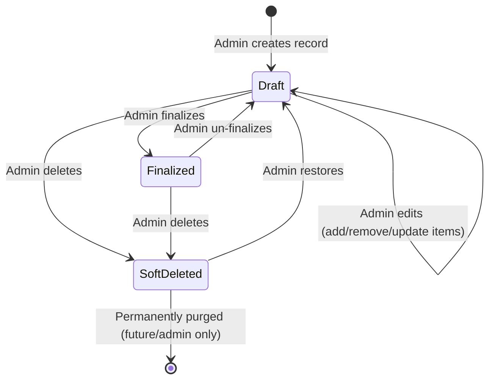
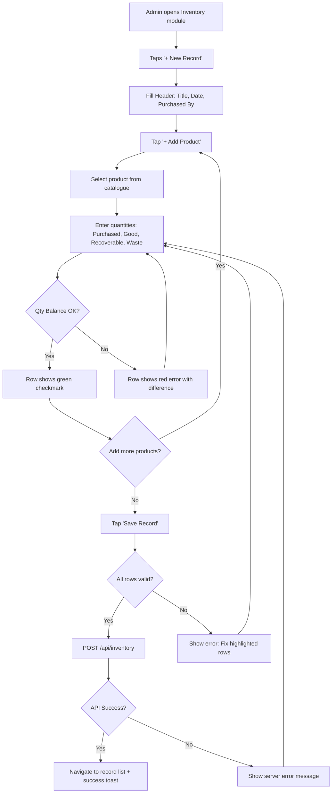
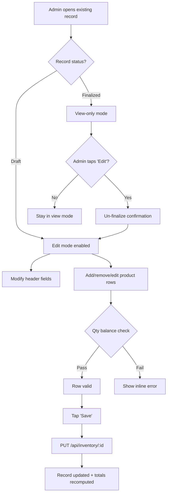
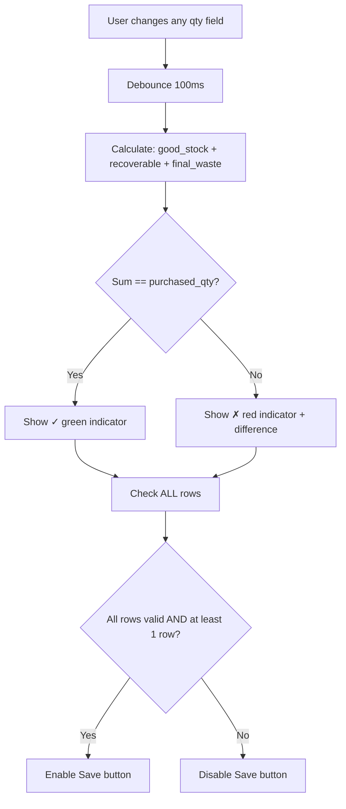
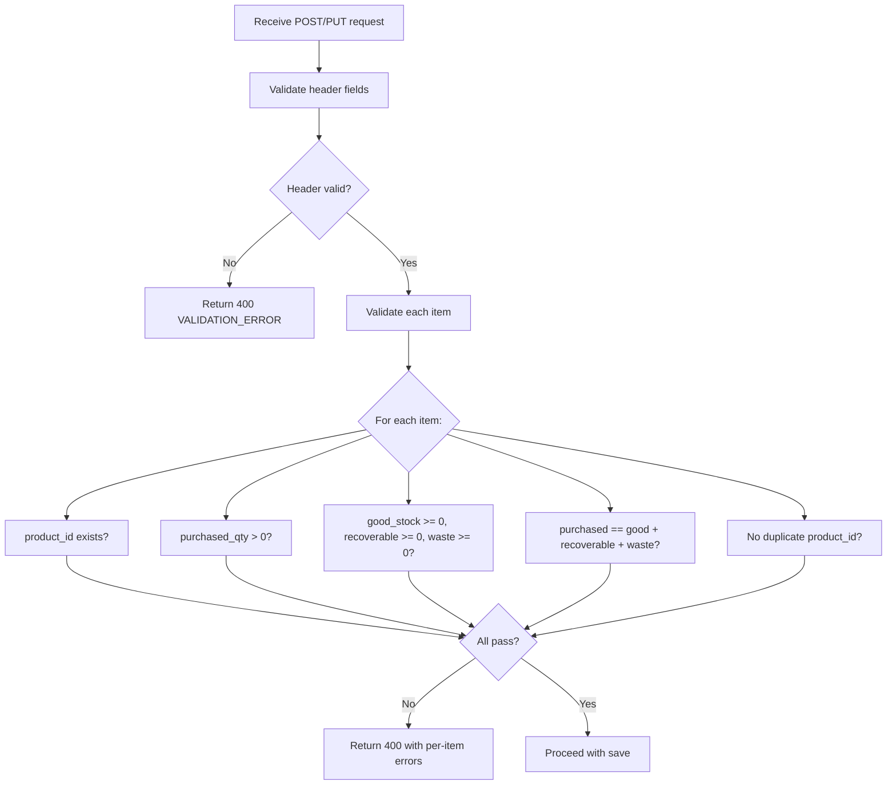
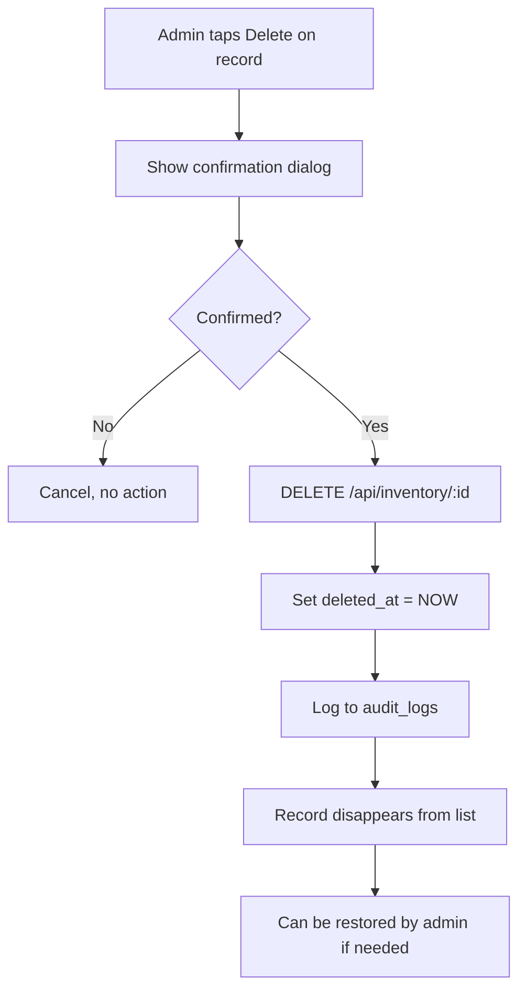
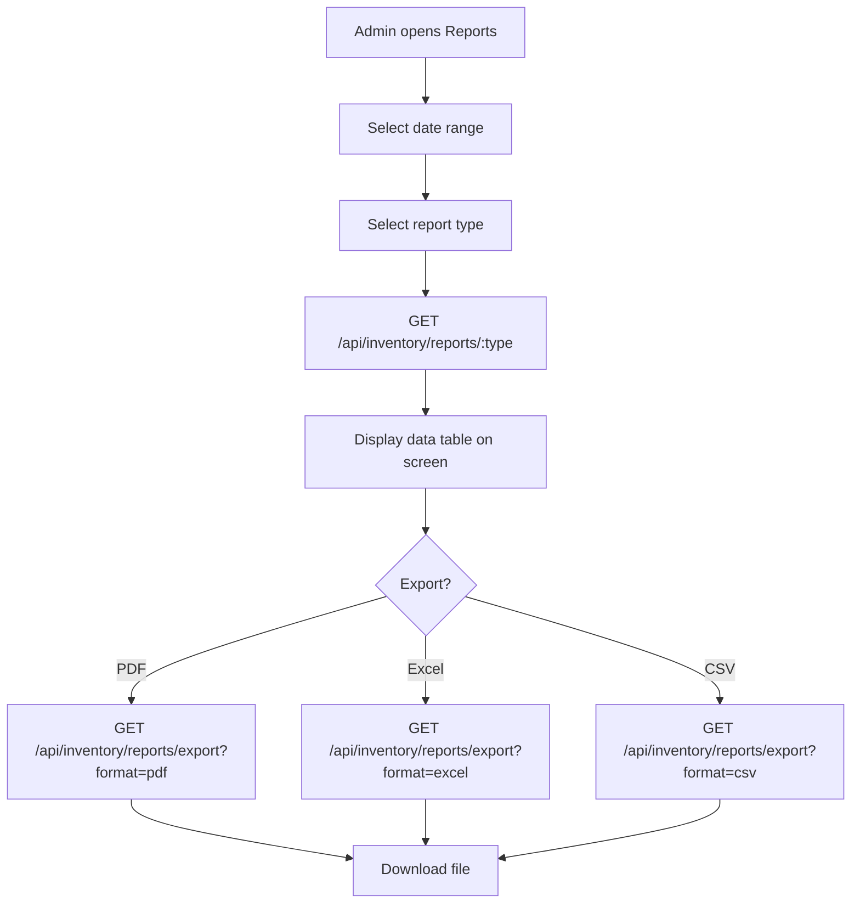
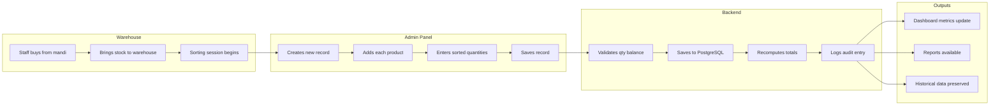
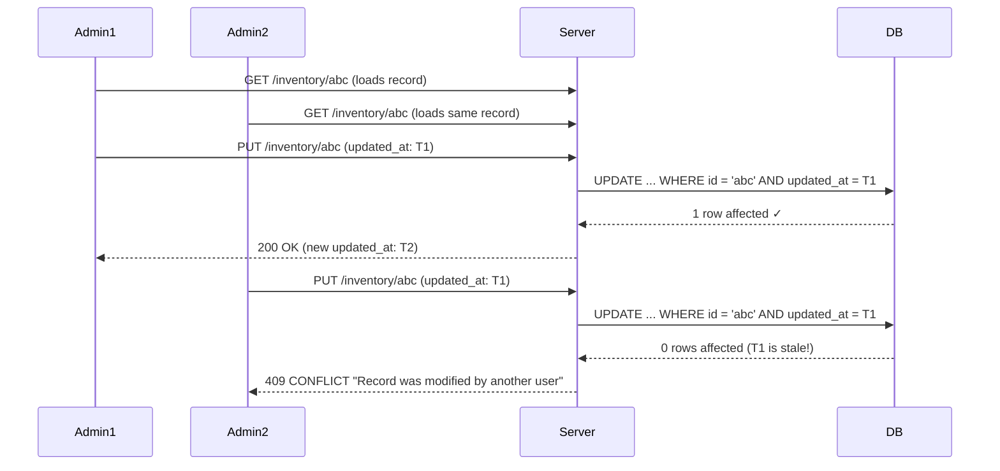

# Workflow — Inventory Management System

## 1. Inventory Record Lifecycle



---

## 2. Create Record Workflow



---

## 3. Edit Record Workflow



---

## 4. Validation Workflow

### Client-Side (Flutter — Real-time)



### Server-Side (Backend — On Save)



---

## 5. Delete Workflow



---

## 6. Reporting Workflow



---

## 7. Data Flow (End-to-End)



---

## 8. Quantity Balance — The Core Business Rule

This is the single most important validation in the system:

```
┌─────────────────────────────────────────────────────────────────┐
│                                                                 │
│   PURCHASED QTY  =  GOOD STOCK  +  RECOVERABLE  +  FINAL WASTE │
│                                                                 │
│   This is a PHYSICAL CONSTRAINT:                                │
│   What comes in MUST be fully accounted for after sorting.      │
│                                                                 │
│   200 kg of potatoes purchased:                                 │
│   → 180 kg fresh and sellable          (Good Stock)            │
│   → 15 kg slightly damaged but usable  (Recoverable)           │
│   → 5 kg rotten/discarded              (Final Waste)           │
│   → 180 + 15 + 5 = 200  ✓                                     │
│                                                                 │
│   If it doesn't add up, either:                                │
│   - Sorting counts were wrong (re-count)                       │
│   - Purchased qty was wrong (re-verify with vendor slip)       │
│   - The system should NOT save invalid data                    │
│                                                                 │
└─────────────────────────────────────────────────────────────────┘
```

**Enforcement layers:**
1. Flutter UI — real-time visual feedback (green/red)
2. Flutter UI — Save button disabled if any row invalid
3. Backend — Validation middleware rejects request
4. Database — CHECK constraint as final safety net

---

## 9. Concurrent Edit Handling

**Current approach (Phase 1):** Last write wins with `updated_at` check.



**Future (Phase 2+):** Real-time collaboration with WebSocket locks.

---

## 10. Audit Trail

Every significant action creates an audit log entry:

| Action | What's Logged |
|--------|---------------|
| Create record | Full record + items snapshot |
| Update header | Old values → New values |
| Add item | New item details |
| Update item | Old qty → New qty |
| Remove item | Removed item details |
| Delete record | Record ID + who + when |
| Restore record | Record ID + who + when |
| Finalize | Status change + who + when |

**Audit log query:**
```sql
SELECT * FROM audit_logs 
WHERE entity_type = 'inventory_record' 
  AND entity_id = :record_id
ORDER BY performed_at DESC;
```

---

## 11. Edge Cases

| Scenario | Handling |
|----------|----------|
| Product deleted from catalogue after being used in records | FK constraint prevents deletion; product deactivated instead |
| Employee marked as "left" but is referenced in old records | Record keeps `purchased_by_name` (denormalized); still viewable |
| Very large record (100+ products) | Paginate items in API? No — max ~100 products exist; always return all |
| Decimal quantities (0.5 kg) | DECIMAL(10,2) supports this; UI shows 2 decimal places |
| Zero purchased with some good stock | CHECK constraint rejects: purchased must be > 0 |
| All waste, no good stock | Valid: purchased=100, good=0, recoverable=0, waste=100 |
| Record for today vs past dates | Both allowed; future dates blocked |
| Duplicate records same title + date | Allowed — different sorting sessions can have same title |
| Network failure mid-save | Transaction rollback; no partial data; retry from client |

---

## 12. Future Extensibility

The workflow is designed so these can be added **without changing the core create/edit flow**:

| Future Feature | Integration Point |
|----------------|------------------|
| **Purchase cost** | Add `unit_price` column to `inventory_items`; new field in product row UI |
| **Supplier** | Add `supplier_id` to `inventory_records` header; dropdown in form |
| **Packing** | New module that reads `good_stock` from inventory items; separate workflow |
| **Stock ledger** | Background job that aggregates `good_stock` by product after finalization |
| **Approval** | Add `approved_by`, `approved_at` to records; new status: `pending_approval` |
| **Photos** | Separate attachments table; upload button on record |
| **Barcode scan** | Alternative product selection method in the "Add Product" flow |
| **Multi-warehouse** | Add `warehouse_id` to records; filter by warehouse in list |
| **Returns** | New `record_type` field: 'purchase', 'return', 'adjustment' |
