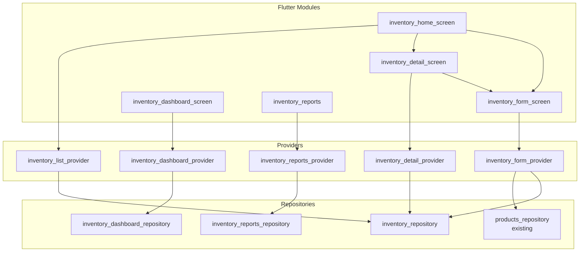

# Folder Structure — Inventory Management System

## 1. Flutter Frontend

```
lib/
├── core/                                  # Shared infrastructure (existing)
│   ├── config/
│   │   └── env.dart
│   ├── network/
│   │   ├── api_client.dart
│   │   └── api_exceptions.dart
│   ├── providers/
│   │   └── providers.dart
│   ├── router/
│   │   └── app_router.dart               # Add inventory routes here
│   ├── utils/
│   │   ├── date_utils.dart
│   │   ├── currency_utils.dart
│   │   ├── number_utils.dart             # NEW: qty formatting (2 decimal places)
│   │   └── media_url.dart
│   └── widgets/
│       ├── admin_shell.dart
│       ├── admin_menu_button.dart        # Add inventory menu item
│       ├── loading_indicator.dart
│       ├── error_view.dart
│       └── confirmation_dialog.dart
│
├── features/
│   ├── ...                               # Existing features
│   │
│   ├── inventory/                        # ──── NEW: INVENTORY MODULE ────
│   │   ├── data/
│   │   │   ├── models/
│   │   │   │   ├── inventory_record.dart          # Record model (header + items)
│   │   │   │   ├── inventory_item.dart            # Single product row model
│   │   │   │   └── inventory_summary.dart         # List item model (for home)
│   │   │   └── repositories/
│   │   │       └── inventory_repository.dart      # All inventory API calls
│   │   │
│   │   ├── presentation/
│   │   │   ├── screens/
│   │   │   │   ├── inventory_home_screen.dart     # List of records + search/filter
│   │   │   │   ├── inventory_form_screen.dart     # Create / Edit record
│   │   │   │   └── inventory_detail_screen.dart   # View record (read-only)
│   │   │   │
│   │   │   └── widgets/
│   │   │       ├── inventory_record_card.dart     # Card in the list
│   │   │       ├── inventory_header_form.dart     # Title + Date + Purchased By
│   │   │       ├── product_table.dart             # The editable product rows
│   │   │       ├── product_row.dart               # Single product row with qty inputs
│   │   │       ├── product_selector.dart          # Bottom sheet to select product
│   │   │       ├── qty_balance_indicator.dart     # Green ✓ / Red ✗ per row
│   │   │       ├── record_summary_bar.dart        # Totals at bottom of form
│   │   │       ├── inventory_search_bar.dart      # Search input
│   │   │       └── date_filter_chip.dart          # Date range filter
│   │   │
│   │   └── providers/
│   │       ├── inventory_list_provider.dart        # List state + pagination
│   │       ├── inventory_form_provider.dart        # Create/edit form state
│   │       └── inventory_detail_provider.dart      # Single record state
│   │
│   ├── inventory_dashboard/              # ──── NEW: DASHBOARD MODULE ────
│   │   ├── data/
│   │   │   └── repositories/
│   │   │       └── inventory_dashboard_repository.dart
│   │   ├── presentation/
│   │   │   ├── screens/
│   │   │   │   └── inventory_dashboard_screen.dart
│   │   │   └── widgets/
│   │   │       ├── metric_card.dart               # Single stat card
│   │   │       ├── top_products_chart.dart        # Bar chart of top products
│   │   │       ├── waste_products_list.dart       # Highest waste items
│   │   │       ├── daily_trend_chart.dart         # Line chart over time
│   │   │       └── period_selector.dart           # Today/Week/Month toggle
│   │   └── providers/
│   │       └── inventory_dashboard_provider.dart
│   │
│   └── inventory_reports/                # ──── NEW: REPORTS MODULE ────
│       ├── data/
│       │   └── repositories/
│       │       └── inventory_reports_repository.dart
│       ├── presentation/
│       │   ├── screens/
│       │   │   ├── inventory_reports_home_screen.dart   # Report type selection
│       │   │   └── inventory_report_view_screen.dart    # Report data + export
│       │   └── widgets/
│       │       ├── report_date_range_picker.dart
│       │       ├── report_data_table.dart
│       │       └── export_format_buttons.dart
│       └── providers/
│           └── inventory_reports_provider.dart
│
└── ...
```

---

## 2. Backend (Node.js / Express)

```
src/
├── config/                               # Existing
│   ├── database.js
│   ├── env.js
│   └── s3.js
│
├── middleware/                            # Existing
│   ├── auth.js
│   ├── role.js
│   ├── validate.js
│   └── error-handler.js
│
├── modules/
│   ├── auth/                             # Existing
│   ├── products/                         # Existing
│   │
│   ├── inventory/                        # ──── NEW: INVENTORY MODULE ────
│   │   ├── inventory.controller.js       # Route handlers
│   │   ├── inventory.service.js          # Business logic + validation
│   │   ├── inventory.repository.js       # PostgreSQL queries
│   │   ├── inventory.routes.js           # Express route definitions
│   │   ├── inventory.validator.js        # Joi/Zod validation schemas
│   │   └── inventory.dto.js             # Response transformations
│   │
│   ├── inventory-reports/                # ──── NEW: REPORTS MODULE ────
│   │   ├── report.controller.js          # Report endpoint handlers
│   │   ├── report.service.js             # Aggregation logic
│   │   ├── report.repository.js          # Report-specific queries
│   │   ├── report.routes.js              # Report routes
│   │   └── generators/
│   │       ├── pdf-generator.js          # PDF export (pdfkit)
│   │       ├── excel-generator.js        # Excel export (exceljs)
│   │       └── csv-generator.js          # CSV export
│   │
│   └── inventory-dashboard/              # ──── NEW: DASHBOARD MODULE ────
│       ├── dashboard.controller.js
│       ├── dashboard.service.js
│       ├── dashboard.repository.js
│       └── dashboard.routes.js
│
├── shared/
│   ├── audit-logger.js                   # Audit log helper (shared with EMS)
│   ├── pagination.js                     # Pagination utility
│   ├── errors.js                         # Custom error classes
│   └── constants.js                      # Enums and constants
│
├── database/
│   ├── migrations/
│   │   ├── ...                           # Existing migrations
│   │   ├── 010_create_inventory_records_table.sql
│   │   ├── 011_create_inventory_items_table.sql
│   │   ├── 012_create_inventory_indexes.sql
│   │   └── 013_add_inventory_audit_triggers.sql
│   └── seeds/
│       └── seed_inventory.js             # Development seed data
│
├── routes/
│   └── index.js                          # Add inventory routes
│
├── app.js
└── server.js
```

---

## 3. Module Responsibility Map

```
┌─────────────────────────────────────────────────────────────────────┐
│ Layer         │ File                    │ Responsibility              │
├─────────────────────────────────────────────────────────────────────┤
│ Routes        │ inventory.routes.js     │ HTTP method + path mapping  │
│ Controller    │ inventory.controller.js │ Parse request, call service │
│ Validator     │ inventory.validator.js  │ Schema validation (Joi/Zod) │
│ Service       │ inventory.service.js    │ Business logic, orchestrate │
│ Repository    │ inventory.repository.js │ SQL queries, DB access      │
│ DTO           │ inventory.dto.js        │ Shape response objects      │
└─────────────────────────────────────────────────────────────────────┘
```

**Data flow:**
```
Request → Router → Validator → Controller → Service → Repository → Database
                                                ↓
Response ← Controller ← DTO ← Service ← Repository ← Database
```

---

## 4. Key File Descriptions

### Frontend (Flutter)

| File | Purpose |
|------|---------|
| `inventory_record.dart` | Full record model with items array; fromJson/toJson |
| `inventory_item.dart` | Single product row; includes qty balance validation method |
| `inventory_summary.dart` | Lightweight model for list cards (no items array) |
| `inventory_repository.dart` | Dio calls to all /api/inventory endpoints |
| `inventory_home_screen.dart` | Paginated list with search, filter, pull-to-refresh |
| `inventory_form_screen.dart` | Create + Edit mode; manages dynamic product rows |
| `product_table.dart` | Manages list of ProductRow widgets; handles add/remove |
| `product_row.dart` | 4 TextFields (purchased, good, recoverable, waste) + validation |
| `qty_balance_indicator.dart` | Shows sum vs purchased, green/red styling |
| `product_selector.dart` | Searchable list of products from catalogue |
| `inventory_list_provider.dart` | AsyncNotifier for list data; handles pagination, search |
| `inventory_form_provider.dart` | StateNotifier for form state; items list, validation |

### Backend (Node.js)

| File | Purpose |
|------|---------|
| `inventory.routes.js` | Defines GET/POST/PUT/DELETE routes with auth middleware |
| `inventory.controller.js` | Extracts params/body, calls service, returns response |
| `inventory.validator.js` | Validates title, date, items array, qty balance per item |
| `inventory.service.js` | Orchestrates: validate → save record → save items → recompute totals → audit log |
| `inventory.repository.js` | Raw SQL: INSERT/UPDATE/SELECT with joins to products table |
| `inventory.dto.js` | Maps DB rows to API response shape (joins product name/unit) |
| `report.service.js` | Aggregation queries: SUM, GROUP BY product/employee/date |
| `pdf-generator.js` | Renders report data into formatted PDF document |

---

## 5. Naming Conventions

| Layer | Convention | Example |
|-------|-----------|---------|
| Flutter models | PascalCase, singular | `InventoryRecord`, `InventoryItem` |
| Flutter providers | camelCase + Provider | `inventoryListProvider` |
| Flutter screens | PascalCase + Screen | `InventoryFormScreen` |
| Flutter widgets | PascalCase | `ProductRow`, `QtyBalanceIndicator` |
| Backend files | dot-notation | `inventory.service.js` |
| DB tables | snake_case, plural | `inventory_records`, `inventory_items` |
| DB columns | snake_case | `purchased_qty`, `good_stock` |
| API routes | kebab-case | `/api/inventory`, `/api/inventory/:id/items` |
| Constants | SCREAMING_SNAKE | `MAX_ITEMS_PER_RECORD`, `QTY_DECIMAL_PLACES` |

---

## 6. Dependency Graph



---

## 7. Shared Code (Reuse from Existing)

These existing components are reused without modification:

| Component | Reused For |
|-----------|-----------|
| `ApiClient` (Dio singleton) | All HTTP calls |
| `ApiException` | Error handling |
| `TokenStorage` | Auth token persistence |
| `AdminShell` | App scaffold/navigation |
| `ProductsRepository` | Loading product catalogue for dropdown |
| Auth middleware (backend) | Protecting inventory endpoints |
| Pagination helper (backend) | List endpoint pagination |
| Error handler (backend) | Consistent error responses |
