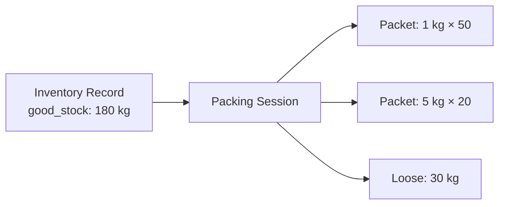
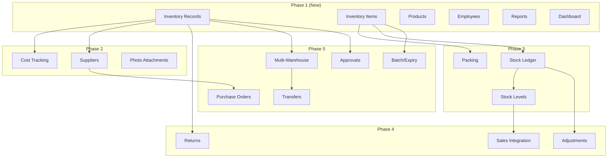

# Future Roadmap — Inventory Management System

## Phase 1: Digital Register (Current)

### Scope
Digitize the physical warehouse notebook. Admin can create inventory records with product-wise sorting data.

### Deliverables

| Feature | Description |
|---------|-------------|
| Inventory Record CRUD | Create, edit, view, soft-delete records |
| Product Table | Add/remove/edit product rows with quantities |
| Qty Balance Validation | Hard-enforced: purchased = good + recoverable + waste |
| Search & Filter | Search by title, filter by date range, purchased by |
| Dashboard | Basic metrics: totals, top products, waste highlights |
| Reports | Summary, product-wise, waste, recoverable, employee |
| Export | PDF, Excel, CSV for all reports |
| Audit Logging | Track who created/modified what and when |

### NOT in Phase 1
- Purchase cost / pricing
- Supplier management
- Stock ledger / running balance
- Packing
- Barcode / QR
- Approval workflows
- Multi-warehouse

---

## Phase 2: Cost & Quality Tracking (Month 2-3)

### 2.1 Purchase Cost Integration
```
New fields on inventory_items:
- unit_price (cost per kg from mandi)
- total_cost (unit_price × purchased_qty)

New fields on inventory_records:
- total_cost (sum of all item costs)
- payment_status (paid, pending, partial)
```

**Impact:** Enables cost reports, margin analysis, supplier comparison (when suppliers are added).

### 2.2 Supplier Management
```
New table: suppliers
- id, name, phone, address, mandi_location, notes

New field on inventory_records:
- supplier_id (nullable FK)
```

**Reports enabled:**
- Cost per supplier
- Quality per supplier (waste %)
- Supplier purchase frequency

### 2.3 Photo Attachments
```
New table: inventory_attachments
- id, inventory_record_id, file_url, file_type, uploaded_by, uploaded_at
```

**Use case:** Photo of mandi receipt, stock condition photos.

### 2.4 Enhanced Dashboard
- Cost trends over time
- Supplier comparison charts
- Waste % trend alerts (flag if waste > threshold)
- Budget vs actual spending

---

## Phase 3: Packing & Stock Ledger (Month 4-6)

### 3.1 Packing Module



**New tables:**
```sql
CREATE TABLE packing_sessions (
    id UUID PRIMARY KEY,
    inventory_item_id UUID REFERENCES inventory_items(id),
    product_id UUID REFERENCES products(id),
    input_qty DECIMAL(10,2) NOT NULL,    -- from good_stock
    packed_qty DECIMAL(10,2) NOT NULL,
    packing_waste DECIMAL(10,2) DEFAULT 0,
    status VARCHAR(20) DEFAULT 'in_progress',
    packed_by UUID REFERENCES employees(id),
    created_at TIMESTAMPTZ DEFAULT NOW()
);

CREATE TABLE packing_packets (
    id UUID PRIMARY KEY,
    packing_session_id UUID REFERENCES packing_sessions(id),
    packet_size DECIMAL(8,2) NOT NULL,   -- e.g., 1.0 (kg)
    packet_count INTEGER NOT NULL,        -- e.g., 50
    total_qty DECIMAL(10,2) NOT NULL,    -- 50.0 kg
    unit VARCHAR(20) DEFAULT 'kg'
);
```

**Business rule:** `SUM(packets.total_qty) + packing_waste = input_qty`

### 3.2 Stock Ledger

Running balance per product:

```sql
CREATE TABLE stock_ledger (
    id UUID PRIMARY KEY,
    product_id UUID REFERENCES products(id),
    transaction_type VARCHAR(20) NOT NULL,  -- 'purchase', 'sale', 'waste', 'adjustment'
    reference_type VARCHAR(50),             -- 'inventory_record', 'order', 'packing'
    reference_id UUID,                      -- FK to source record
    qty_in DECIMAL(10,2) DEFAULT 0,
    qty_out DECIMAL(10,2) DEFAULT 0,
    balance DECIMAL(10,2) NOT NULL,         -- running balance after this txn
    date DATE NOT NULL,
    created_at TIMESTAMPTZ DEFAULT NOW()
);
```

**Trigger:** When inventory record is finalized:
- `qty_in = good_stock` for each product
- Updates running balance

### 3.3 Stock Levels on Products

```sql
ALTER TABLE products ADD COLUMN current_stock DECIMAL(10,2) DEFAULT 0;
ALTER TABLE products ADD COLUMN stock_updated_at TIMESTAMPTZ;
```

Maintained by stock ledger triggers.

---

## Phase 4: Sales Integration & Returns (Month 7-9)

### 4.1 Sales ↔ Inventory Link

When orders are fulfilled:
- Stock ledger records `qty_out` for each product sold
- Running balance decreases
- Dashboard shows: purchased today vs sold today vs remaining

### 4.2 Returns Handling

```sql
-- inventory_records gets a type field
ALTER TABLE inventory_records ADD COLUMN record_type VARCHAR(20) DEFAULT 'purchase';
-- Values: 'purchase', 'return', 'adjustment', 'transfer'
```

Returns are just inventory records with `record_type = 'return'`:
- Purchased qty → returned qty
- Good stock → resaleable returned
- Waste → damaged returns (write-off)

### 4.3 Inventory Adjustments

For discrepancies found during stock counts:
- `record_type = 'adjustment'`
- Can be positive (found extra) or negative (missing stock)
- Requires approval (links to approval workflow)

---

## Phase 5: Enterprise Features (Month 10+)

### 5.1 Multi-Warehouse

```sql
CREATE TABLE warehouses (
    id UUID PRIMARY KEY,
    name VARCHAR(100) NOT NULL,
    address TEXT,
    city VARCHAR(50),
    is_active BOOLEAN DEFAULT true
);

ALTER TABLE inventory_records ADD COLUMN warehouse_id UUID REFERENCES warehouses(id);
ALTER TABLE stock_ledger ADD COLUMN warehouse_id UUID REFERENCES warehouses(id);
```

### 5.2 Stock Transfers

```sql
CREATE TABLE stock_transfers (
    id UUID PRIMARY KEY,
    from_warehouse_id UUID REFERENCES warehouses(id),
    to_warehouse_id UUID REFERENCES warehouses(id),
    status VARCHAR(20) DEFAULT 'initiated',  -- initiated, in_transit, received
    initiated_by UUID REFERENCES users(id),
    initiated_at TIMESTAMPTZ,
    received_by UUID REFERENCES users(id),
    received_at TIMESTAMPTZ
);

CREATE TABLE stock_transfer_items (
    id UUID PRIMARY KEY,
    transfer_id UUID REFERENCES stock_transfers(id),
    product_id UUID REFERENCES products(id),
    qty_sent DECIMAL(10,2) NOT NULL,
    qty_received DECIMAL(10,2),
    transit_damage DECIMAL(10,2) DEFAULT 0
);
```

### 5.3 Approval Workflow

```sql
ALTER TABLE inventory_records ADD COLUMN requires_approval BOOLEAN DEFAULT false;
ALTER TABLE inventory_records ADD COLUMN approved_by UUID REFERENCES users(id);
ALTER TABLE inventory_records ADD COLUMN approved_at TIMESTAMPTZ;
ALTER TABLE inventory_records ADD COLUMN rejection_reason TEXT;
```

Status flow: `draft` → `pending_approval` → `approved` / `rejected` → `finalized`

### 5.4 Batch & Expiry Tracking

```sql
ALTER TABLE inventory_items ADD COLUMN batch_number VARCHAR(50);
ALTER TABLE inventory_items ADD COLUMN manufacturing_date DATE;
ALTER TABLE inventory_items ADD COLUMN expiry_date DATE;
ALTER TABLE inventory_items ADD COLUMN barcode VARCHAR(100);
```

### 5.5 Purchase Orders (Optional — only if business grows)

```sql
CREATE TABLE purchase_orders (
    id UUID PRIMARY KEY,
    po_number VARCHAR(50) UNIQUE,
    supplier_id UUID REFERENCES suppliers(id),
    status VARCHAR(20) DEFAULT 'draft',
    expected_date DATE,
    total_amount DECIMAL(12,2),
    notes TEXT,
    created_by UUID REFERENCES users(id),
    created_at TIMESTAMPTZ DEFAULT NOW()
);

CREATE TABLE purchase_order_items (
    id UUID PRIMARY KEY,
    po_id UUID REFERENCES purchase_orders(id),
    product_id UUID REFERENCES products(id),
    ordered_qty DECIMAL(10,2) NOT NULL,
    unit_price DECIMAL(10,2),
    received_qty DECIMAL(10,2) DEFAULT 0
);
```

Link: `ALTER TABLE inventory_records ADD COLUMN po_id UUID REFERENCES purchase_orders(id);`

---

## Architecture Evolution Diagram



---

## Migration Safety Principles

1. **All new columns are nullable or have defaults** — zero-downtime deployments
2. **New tables are additive** — never rename/drop existing columns
3. **Enums extended, never modified** — existing values always valid
4. **Feature flags** — new features hidden until backend ready
5. **Backward-compatible APIs** — new fields in response are optional; old clients ignore them
6. **Data migrations are separate from schema migrations** — run independently after deploy

---

## Decision Log

| Decision | Rationale | Revisit When |
|----------|-----------|--------------|
| No stock ledger Phase 1 | Business doesn't track running balance; sells same day | When stock carryover becomes common |
| No purchase cost Phase 1 | Current workflow: admin just records qty, not price | When finance team needs cost reports |
| No suppliers Phase 1 | Same mandi vendors daily; relationships are informal | When vendor comparison needed |
| No packing Phase 1 | Packing is a separate physical process done later | When packing team gets tablets |
| Denormalized totals on record | Avoids JOIN on every list fetch; 95% of views are list | Never — this is a performance optimization |
| Single record type initially | Only "purchase" records exist today | When returns or adjustments start |
| Hard qty balance constraint | Physical reality: input must equal sum of outputs | Never — this is a physics constraint |
| Items cascade-delete with record | Items have no independent lifecycle | If items get referenced elsewhere (packing) |
